# 🐕 TailWag Studio — 3D Filament Painting & TD Lithophane Engine (`v1.1.2`)

[](CHANGELOG.md)
[](https://github.com/everyday3d/tailwag/releases)
[](#mcp-server-agentic-solving--headless-3mf-generation)
[](LICENSE)

> **Next-Generation Desktop 3D Filament Painting (Front-Lit Beer-Lambert TD Blending), AI Palette & Layer-Swap Solver, 2.5D Parametric CAD Cutouts, and Native Bambu Studio / OrcaSlicer `.3MF` Exporter + Built-in MCP Server.**

> [!WARNING]
> **New release, bugs possible.** TailWag Studio 1.1 is new and may contain bugs, and predicted colours are estimates until you calibrate your filaments. If you find a problem, please [open an issue](https://github.com/everyday3d/tailwag/issues).

> [!NOTE]
> **Windows shows a blue warning or macOS blocks the app?** The releases are not code-signed yet. See [how to open on Windows](#installing-on-windows-and-the-blue-windows-protected-your-pc-screen) and [how to open on macOS](#installing-on-macos-apple-silicon--intel).

> **Independent project.** TailWag Studio is not affiliated with or endorsed by HueForge, Bambu Lab, Prusa, or any filament maker. We do not own or claim to own HueForge or any other third-party name or trademark. See [NOTICE.md](NOTICE.md).
---

## 🌟 Key Features

1. **🔬 Real-Time Beer-Lambert + Kubelka-Munk Optical TD Viewport (`Viewport3D.tsx`)**
   - Interactive Three.js WebGL2 3D relief preview with real-time vertex color transmission blending, studio key-light azimuth/elevation controls, **X-Ray Layer Cutaway Scrubber**, **Split-Screen Source Wipe Compare**, and **Front-Lit vs. Back-Lit Lithophane** toggle.
2. **📦 Native Bambu Studio & OrcaSlicer `.3MF` Project Export (`exporter3mf.ts`)**
   - Exports ready-to-slice `.3mf` project packages pre-configured with `100%` aligned rectilinear infill, base/layer height rules, filament hex palette, height-range color modifiers, and a `>4 Color Single-AMS Chaining Playbook`.
3. **🧠 AI Palette & Layer-Swap Auto-Solver (`autoSolver.ts`)**
   - Optimizes filament combinations and exact layer swap Z-heights in CIE LAB perceptual space ($\Delta E$) across your **Owned / Active AMS Spools** or the full multi-brand catalog.
4. **📏 Built-in TD Calibrator & Live Bambu Fleet Studio AMS Sync (`TdCalibratorModal.tsx`)**
   - Generates a 7-minute **16-Step TD Calibration Step-Wedge (`.STL`)**, calculates exact filament Transmission Distance ($TD$ in mm), and syncs live AMS trays from Home Assistant (`bambu_fleet_studio`).
5. **📐 2.5D Parametric CAD Shapes, Frames, Clocks & Cutouts (`cadMeshBuilder.ts`)**
   - Built-in silhouettes (*Rectangle*, *Rounded Plaque*, *Circle/Clock*, *Hexagon*, *Crest Shield*, *BoxerDawg Medallion*), 3D raised frames (*Beveled*, *Modern Lip*, *Stepped*), **wall clock Mode** (center quartz shaft bore, rear $56\times56\text{mm}$ movement cavity, raised top-layer stencil numerals), **Keychain Bores**, and **Rear Neodymium Magnet Pockets**.
6. **🤖 Built-in TailWag MCP Server (experimental) (`mcp/server.ts` / `dist-electron/mcp/server.js`)**
   - Standard JSON-RPC 2.0 stdio Model Context Protocol (MCP) server allowing AI agents to autonomously list filaments, solve optimal TD palettes, simulate layer stacks, calibrate TDs, and export `.3mf` / `.stl` projects headlessly.

---

## Spotlight: a tour of the studio

These screenshots are taken from the app itself with the bundled sample portrait and a 4-colour recipe. Colours in the preview are predictions until you calibrate your own filaments.

### Loading screen
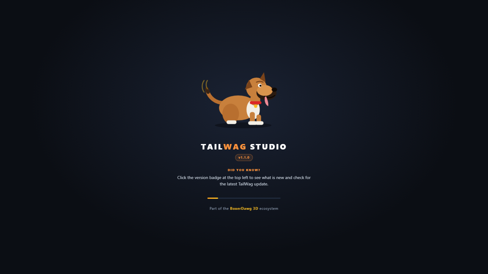

The app opens with a tail-wagging dog, the version number and a randomly ordered "Did you know?" tip. There are 49 tips covering TD, calibration, slicer settings and the less obvious features, and none repeats until all have been shown. The screen is part of the page itself, so it appears instantly, before the heavy 3D code has loaded.

### Faithful or Vivid
| Faithful (default) | Vivid |
| --- | --- |
| 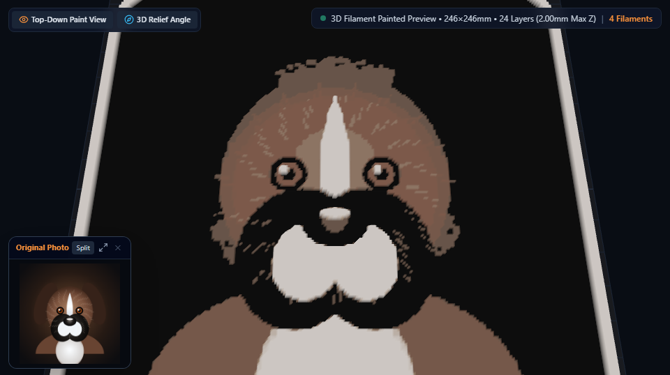 | 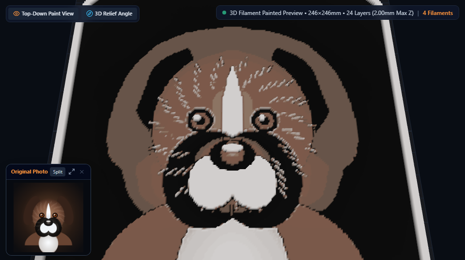 |

The toolbar toggle changes how the photo is turned into relief. **Faithful** gives each column the stack depth whose predicted colour is closest to the photo's own colour, measured with standard CIEDE2000 and with no saturation boost. **Vivid** is the earlier brightness-based mapping with boosted saturation: bolder, but a deliberate departure from the photo. Switching modes re-tunes the filament swap layers automatically.

### Accuracy or Beauty lighting
| Accuracy (default) | Beauty |
| --- | --- |
|  | 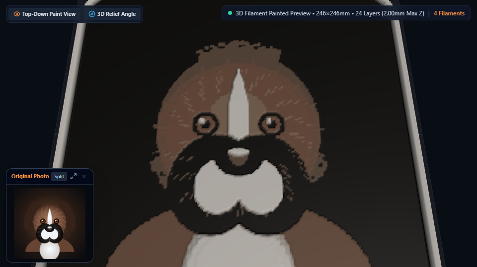 |

**Accuracy** shows each column's predicted colour with no lighting, so what you see is what the model expects the plastic to look like. **Beauty** adds studio lighting and shading for a more photographic picture of the 3D relief, but the shading shifts how colours read.

### Split wipe compare
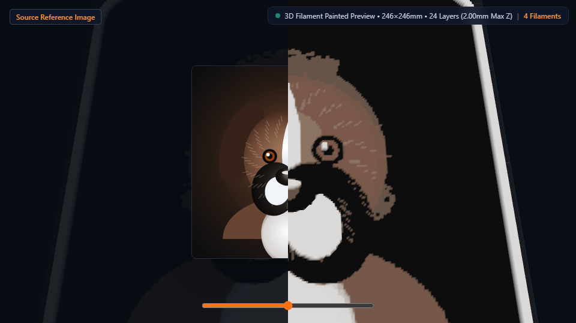

Drag the slider to wipe between your original photo and the predicted print. It is the quickest way to spot where the palette loses detail or shifts a colour.

### Layer timeline
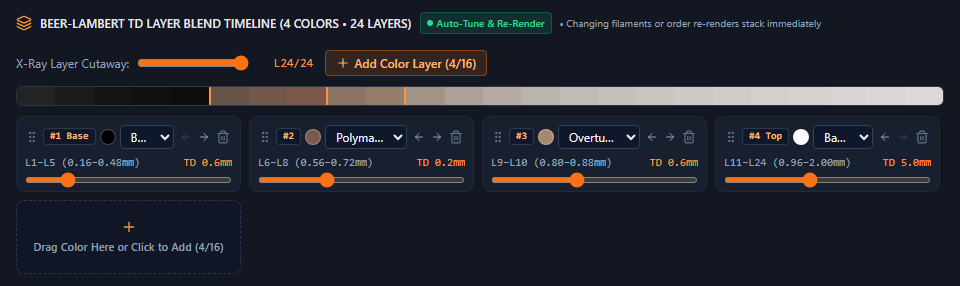

Each coloured block is one filament and the layers it prints. The gradient bar above shows the predicted colour of every layer. Drag a block's slider to move where that filament starts and ends, swap the spool from the drop-down, reorder with the arrows, or add another colour layer. The 3D preview re-renders immediately and the first layer is 0.16 mm with 0.08 mm layers after it.

### Filament library
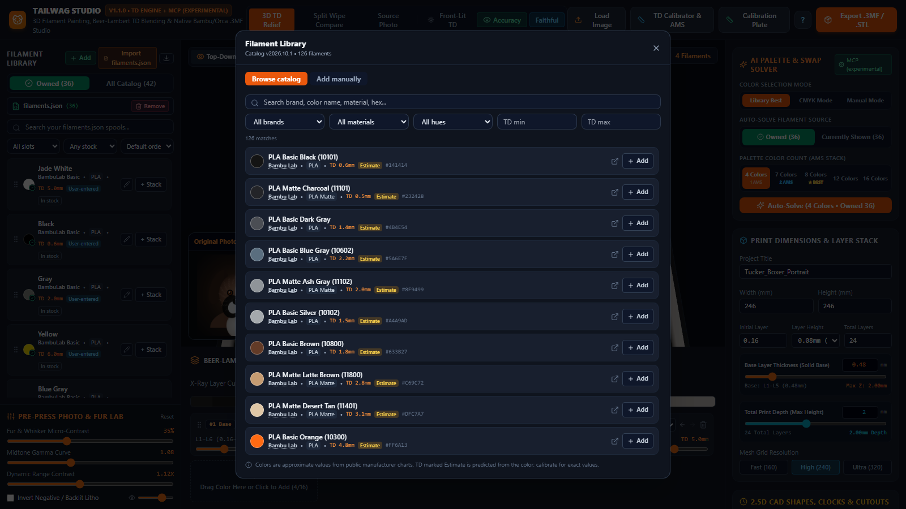

A bundled, offline catalog of manufacturer filaments you can search by brand, material, colour name, hue family and TD range. Each entry links to the manufacturer's page so you can check the data, and carries a badge showing where its TD came from. Catalog TD values are labelled **Estimate** because they are predicted from the colour, not measured. Add what you own to **My Filaments**, then filter by AMS slot or stock status and sort by TD.

### Edit a filament
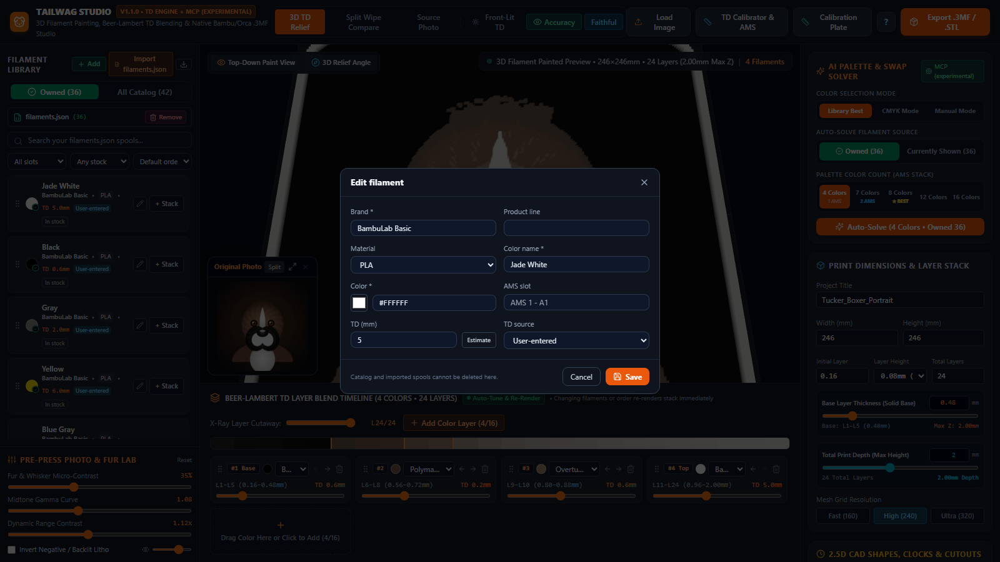

Every spool can be edited: name, brand, material, colour, TD, TD source and AMS slot. TD sources rank from **Estimate** and **Catalog** up through **User-entered** to **Measured**, and a weaker source never silently overwrites a stronger one. Editing a spool that is in the stack updates the stack and re-tunes the swap layers.

### Calibration plate
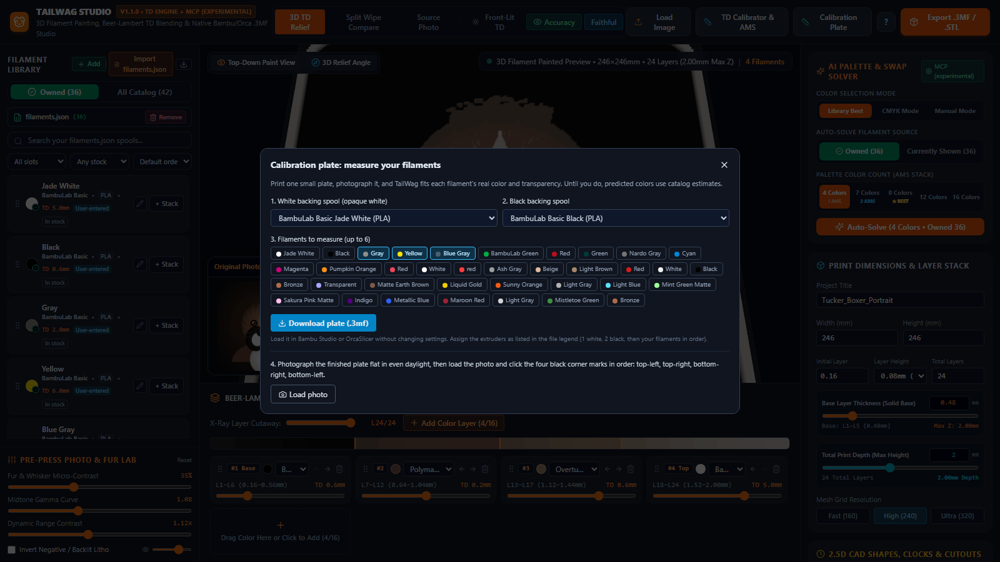

Pick a white and a black backing spool and up to six filaments to measure, then download a small plate as a `.3mf` with one extruder per part. Print it, photograph it flat in even daylight, click the four corner marks, and TailWag fits each filament's real colour and transparency. Fitted spools show a **Calibrated** badge with the fit error, and every colour calculation then uses the measured values instead of the estimate.

### Export with a predicted fidelity report
| Schedule and preview | Predicted fidelity |
| --- | --- |
| 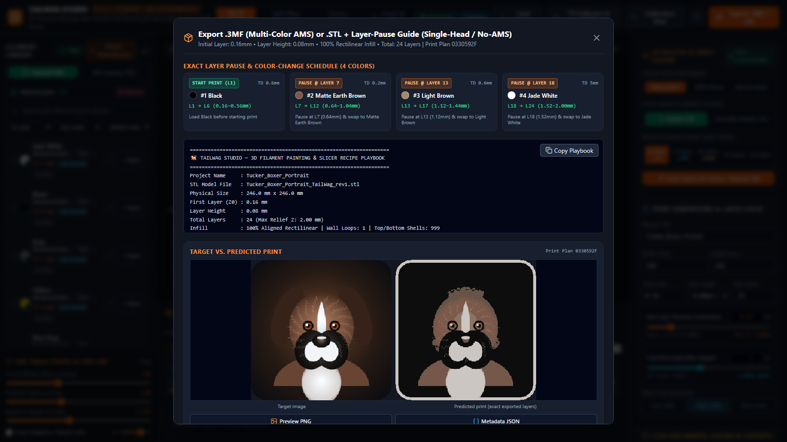 | 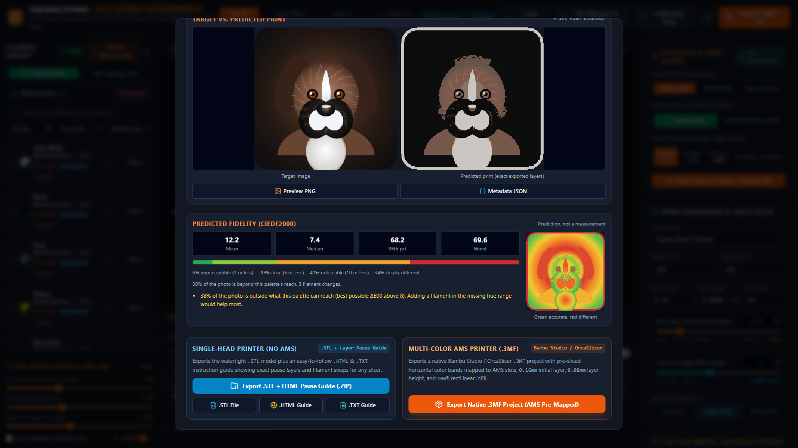 |

The export dialog lists the exact pause layer and heights for every colour change, a side-by-side of the target and the predicted print drawn from the exact layers that will be exported, and a predicted fidelity report: mean, median, 95th-percentile and worst colour difference, how much of the photo is imperceptible, close, noticeable or clearly different, and a heat map where green is accurate and red will differ. For this sample, 38% of the photo is outside what a 4-colour palette can reach, and the report says so and suggests adding a filament in the missing hue range. It is a prediction, not a measurement. Every file is re-read and checked against the print plan before it is written, and a mismatch blocks the export.

### Shape, frame and extras
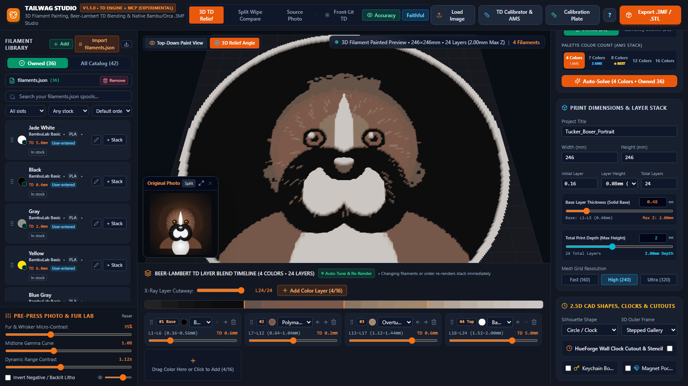

Cut the print to a rectangle, rounded plaque, circle or clock face, hexagon tile, crest shield or medallion, and choose a beveled, raised-lip or stepped frame, or none. Optional extras cut a wall-clock shaft hole and movement pocket, a keychain hole, and rear magnet pockets.

### About and updates
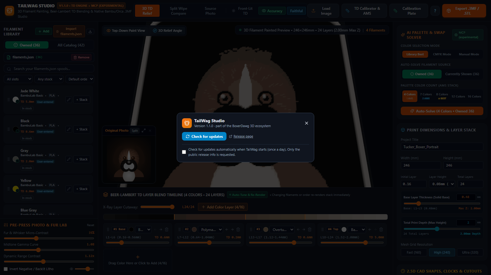

Click the version badge to see the version and check for the newest release. A quiet once-a-day check on startup can be turned off in the same dialog, and only the public release information is requested.

## 🤖 MCP Server (Experimental: Agentic Solving & Headless 3MF Generation)

> The MCP server is experimental. It exports a built-in demo relief with a grayscale solver, not your own photos or the Faithful color matching, and its tools may change.

Agents can connect to the compiled TailWag MCP server (`node dist-electron/mcp/server.js`) over `stdio`:

| MCP Tool Name | Description |
| :--- | :--- |
| `tailwag_list_filaments` | Lists verified filament spools with brand, hex color, $TD$ (mm), and AMS/owned status. |
| `tailwag_solve_palette` | Solves optimal filament combinations and layer swap heights for target hex colors or portraits. |
| `tailwag_simulate_layer_stack` | Simulates Beer-Lambert TD blending for any filament stack and returns the per-layer hex LUT. |
| `tailwag_export_3mf_project` | Headlessly builds a watertight 2.5D mesh with CAD cutouts and writes `.3mf` + `_Swap_Playbook.txt`. |
| `tailwag_calibrate_td` | Computes filament $TD$ from step-wedge opacity readings and exports the calibration wedge `.stl`. |

## Installing on Windows, and the blue "Windows protected your PC" screen

TailWag Studio is a new, small project and the installer is **not code-signed yet** (a code-signing certificate costs money and a new app also has no "reputation" with Microsoft). Because of that, Windows may stop you when you run it, even though the file is fine. This is normal for unsigned apps and does not mean the file is infected.

### The blue screen ("Windows protected your PC", Microsoft Defender SmartScreen)
1. Click **More info** (the small link under the message).
2. Click **Run anyway**.

The installer then runs normally. You only need to do this the first time you run each new download.

### "This file is blocked" or the installer will not start
Windows marks files downloaded from the internet. To remove that mark:
1. Right-click the downloaded `.exe` and choose **Properties**.
2. At the bottom of the **General** tab, tick **Unblock** and click **OK**.
3. Run the file again.

### Your browser says it is "not commonly downloaded" or "may be dangerous"
Edge and Chrome show this for any new file without a reputation yet. Choose **Keep** (in the downloads list, open the three dots, then **Keep**, then **Keep anyway**).

### Antivirus quarantined the file
Some antivirus programs distrust new unsigned apps. If one removes the installer, restore it from quarantine and add the file or folder to the exclusion list, or use the portable build.

### Check that the file is the real one
Each file on the [releases page](https://github.com/everyday3d/tailwag/releases) shows a **SHA-256** checksum next to it. To compare it with your download, open PowerShell in the folder with the file and run:

```powershell
Get-FileHash .\TailWag-Setup-1.1.2.exe -Algorithm SHA256
```

The two values should be identical. You can also read every line of the source code in this repository.

Still stuck? Please [open an issue](https://github.com/everyday3d/tailwag/issues) and say which message you see.

## Installing on macOS (Apple Silicon & Intel)

Releases are published as `.dmg` installers and `.zip` bundles on the [releases page](https://github.com/everyday3d/tailwag/releases):
- **Apple Silicon (M1, M2, M3, M4)**: Download `TailWag-Setup-*-mac-arm64.dmg`.
- **Intel Macs**: Download `TailWag-Setup-*-mac-x64.dmg`.

Open the downloaded `.dmg` and drag **TailWag Studio.app** into your `/Applications` folder.

### First launch: Right-click > Open (Unsigned App Gatekeeper)

Because TailWag Studio is a free open-source project without a paid Apple Developer certificate, macOS Gatekeeper blocks opening on a normal double-click. **Unsigned macOS apps need right-click, Open on first launch**:

1. **Right-click (or Control-click)** `TailWag Studio.app` in `/Applications`.
2. Select **Open** from the menu.
3. Click **Open** in the confirmation dialog.

macOS remembers your permission and will open the app normally on standard double-click thereafter.

#### If macOS says "TailWag Studio is damaged and can't be opened"
If Gatekeeper prevents opening or flags the file:
- **Terminal (cleanest)**: Open Terminal and run:
  ```bash
  xattr -cr /Applications/TailWag\ Studio.app
  ```
  This clears the `com.apple.quarantine` extended attribute applied to downloads.
- **System Settings**: Open **System Settings > Privacy & Security**, scroll down to the **Security** section, and click **Open Anyway**.
## Notices and reporting bugs

TailWag Studio is a new release and can have bugs. Please report them on the [issue tracker](https://github.com/everyday3d/tailwag/issues); the bug report form asks for your version and the steps to reproduce.

HueForge, Bambu Lab, Bambu Studio, OrcaSlicer, PrusaSlicer and the filament brands named in this project belong to their respective owners. We do not own or claim to own them, and this project is not affiliated with or endorsed by any of them. Full details are in [NOTICE.md](NOTICE.md).

## License

TailWag Studio is released under the [MIT License](LICENSE). Filament catalog data is described in [DATA_SOURCES.md](DATA_SOURCES.md).
