# 🐕 TailWag Studio (`v1.4.1`)

[](CHANGELOG.md)
[](https://github.com/everyday3d/tailwag/releases)
[](https://github.com/everyday3d/tailwag/wiki)
[](LICENSE)

**Turn any photo into a multi-colour 3D print.** TailWag Studio picks a few filaments, works out which layer to swap each one at, and shows you what the print will look like before you print it. Thin layers of filament let the colours underneath show through, so four spools can make a picture with dozens of shades. When you are happy, export a ready-to-print project for Bambu Studio or OrcaSlicer, or an STL with a simple pause guide for any printer.

**[Download for Windows or macOS](https://github.com/everyday3d/tailwag/releases/latest)**. It's free and works offline.

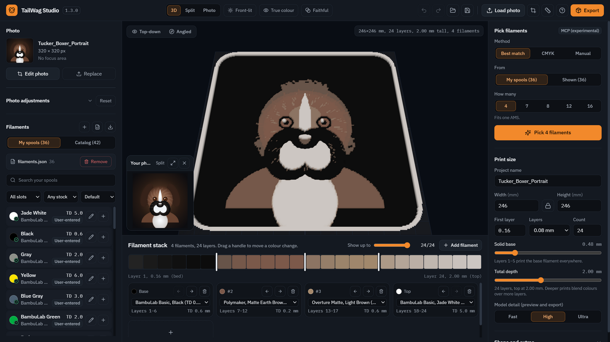

> [!WARNING]
> **New release, bugs possible.** Predicted colours are estimates until you calibrate your filaments. If you find a problem, please [open an issue](https://github.com/everyday3d/tailwag/issues).

> [!NOTE]
> **Windows shows a blue warning or macOS blocks the app?** The app is not code-signed yet. See [how to open on Windows](#installing-on-windows-and-the-blue-windows-protected-your-pc-screen) and [how to open on macOS](#installing-on-macos-apple-silicon--intel).

---

## What it does

- **Picks your filaments for you.** Choose how many colours you want (4 fits one AMS) and TailWag picks the best mix from the spools you own or from a catalog of 126 real filaments.
- **Shows the print before you print it.** A 3D preview shows the predicted colours, with a side-by-side compare against your photo.
- **Cuts the print to your subject.** It can find your dog, a person or an object in the photo and cut the print to its outline automatically.
- **Crop, turn and focus.** Crop and straighten the photo, and paint over what matters most, like a face, so it gets the best colours.
- **Fixes poor phone photos.** One click makes a dark, dull or blurry photo brighter, cleaner and sharper.
- **Recolours.** Click a colour in the picture and choose what it becomes, such as an orange cartoon dog that should be light brown.
- **Makes gifts in one click.** Templates for a coaster, ornament, keychain, fridge magnet or desk stand set the size, shape, holes and depth for you.
- **Adds a name.** Raise a name and a date on a name plate, like a memorial plaque, in one of the bundled fonts or any font on your computer.
- **Makes wall clocks.** Raised numbers, or numbers cut right through with a coloured back plate behind them that also holds the clock movement and hangs on the wall.
- **Holds your magnets.** Pockets sized for the magnets you have; the back gets thicker by itself when they need room.
- **Shapes and frames.** Rectangle, rounded plaque, circle, hexagon, shield or medallion, with a raised frame, and a keychain hole.
- **Exports a print you can trust.** A Bambu Studio or OrcaSlicer project with every colour already set up, or an STL with a step-by-step pause guide. Every file is checked against the plan before it is saved.
- **Gets more accurate as you calibrate.** Print one small plate, take a photo, and TailWag measures how your own filaments really look.

---

## A tour of the studio

These screenshots use the sample portrait that comes with the app and four filaments. Colours in the preview are predictions until you calibrate your own filaments.

### Tucker says hello


While the app starts, Tucker the boxer is printed layer by layer, then wags his tail. Each time you open the app you get a new "Did you know?" tip.

### Cut to the subject
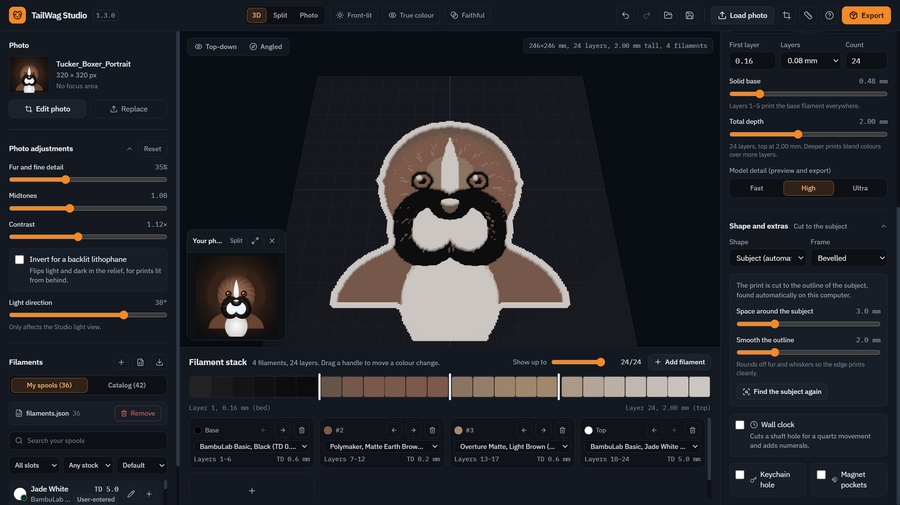

In **Shape and extras**, choose **Subject (automatic)**. TailWag finds the subject of your photo and cuts the print to its outline, with no tracing. It takes about 5 to 10 seconds, runs on your computer, and your photo is never uploaded. Use the sliders to add space around the subject and smooth the edge, so fur and whiskers print cleanly. Frames follow the outline too.

### Faithful or Vivid
| Faithful (default) | Vivid |
| --- | --- |
| 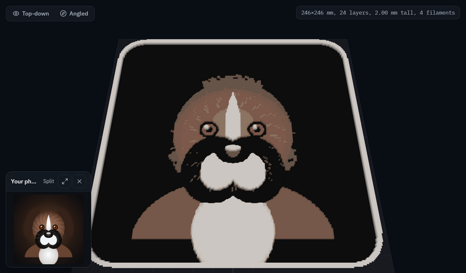 | 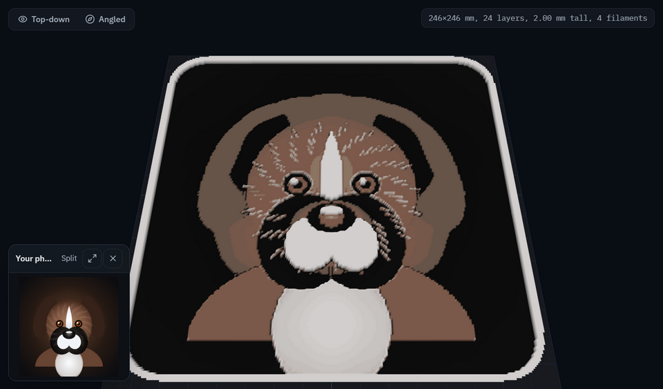 |

**Faithful** gets as close to your photo's real colours as your filaments allow. **Vivid** makes colours bolder and adds more depth, but strays further from the photo. Switch between them with the button at the top of the window.

### True colour or Studio light
| True colour (default) | Studio light |
| --- | --- |
|  | 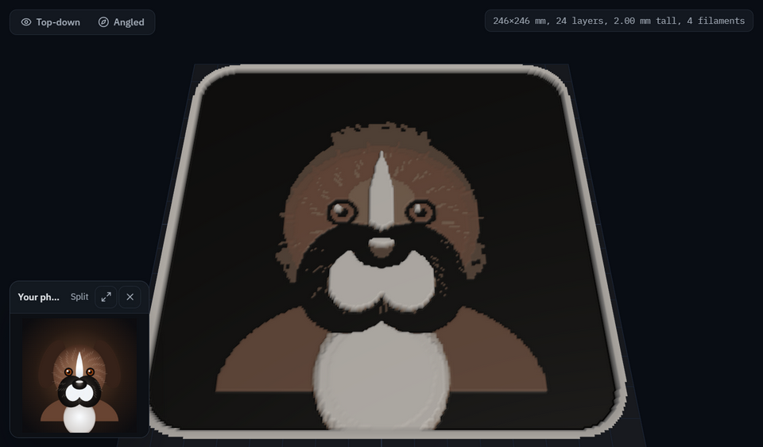 |

**True colour** shows the predicted colour of the print with no lighting, so you see what the plastic should look like. **Studio light** adds light and shadow so you can see the 3D shape, but the shading changes how the colours look. The **Front-lit / Backlit** button shows how the print looks on a wall or with light shining through it.

### Compare with your photo
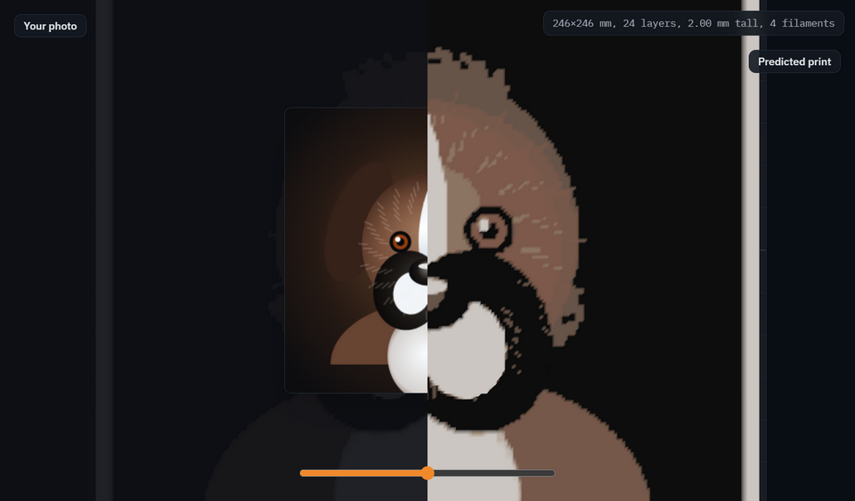

Choose **Split** at the top and drag the slider to wipe between your photo and the predicted print. It's the quickest way to spot where a colour is off or detail is lost.

### The filament stack
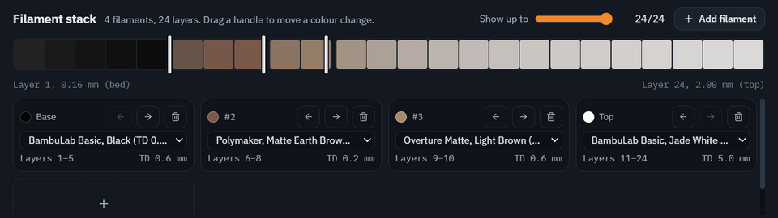

The bar shows the colour of every layer, from the bed to the top, with one band per filament. Drag the white handles to change where one filament stops and the next starts, and the preview updates right away. Below the bar, pick a different spool, change the order or add another colour.

### Crop, turn and focus area
| Crop and rotate | Focus area |
| --- | --- |
| 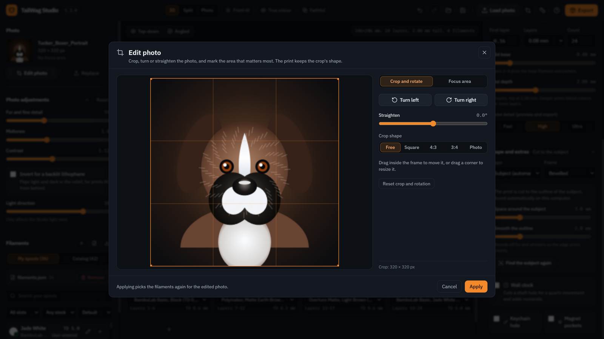 | 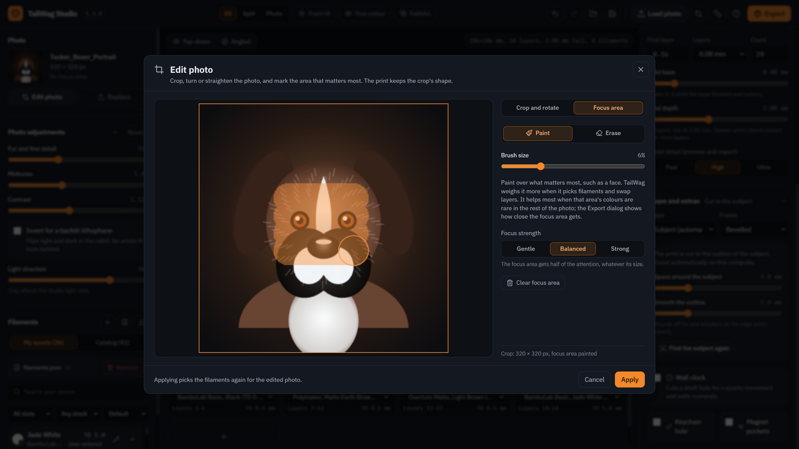 |

**Edit photo** opens by itself after you load a photo, or use the crop button at the top. Turn the photo, straighten it, and crop it freely or to a square, 4:3 or 3:4. On **Focus area**, paint over what matters most, such as a face. TailWag gives that area priority when it picks filaments.

### Export
| Choose how to print | Predicted result |
| --- | --- |
| 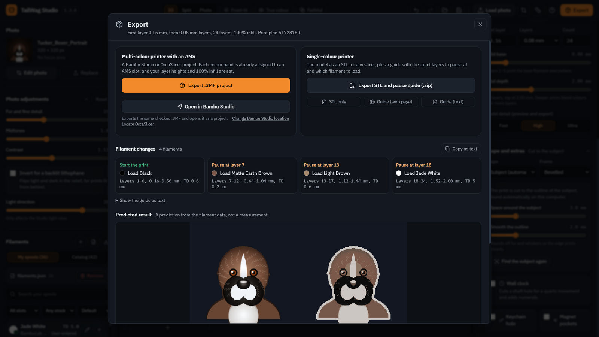 | 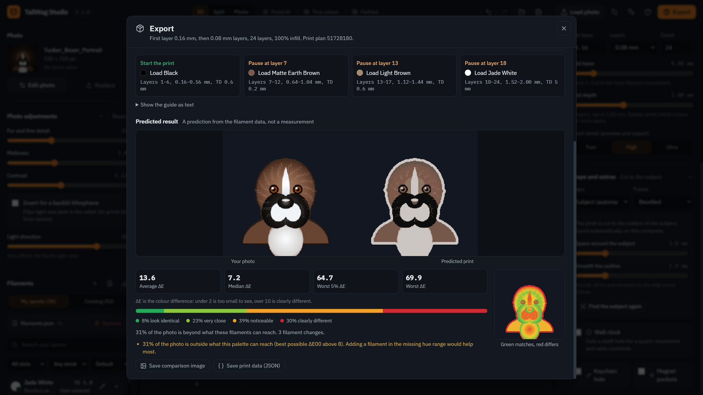 |

- **Printer with an AMS:** export a .3MF project, or send it straight to Bambu Studio. Every colour is already assigned and the layer height and infill are set.
- **Single-colour printer:** get an STL and a guide that tells you exactly when to pause and which filament to load.
- **Predicted result:** shows your photo next to the predicted print, a colour-accuracy score, and a heat map: green matches, red differs. If your filaments can't reach some colours, it says so and suggests what to add.

### Your filaments
| Add from the catalog | Edit a spool |
| --- | --- |
| 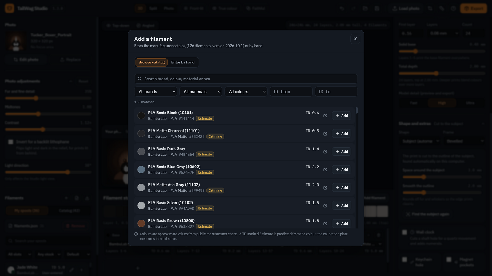 | 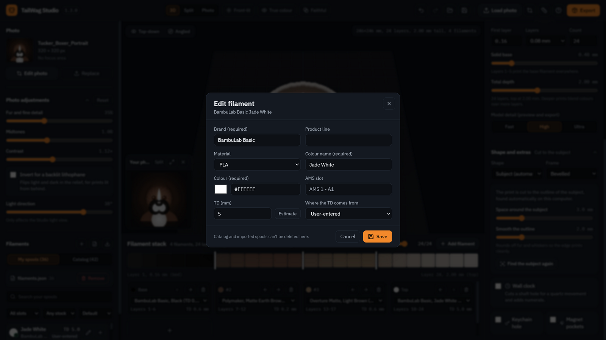 |

Search 126 real filaments from Bambu Lab, Polymaker, Elegoo, eSun, Prusament and more, and add the ones you own. You can also enter a spool by hand or import a `filaments.json` library. Each spool shows its **TD** (how see-through it is). Catalog values are marked **Estimate** until you measure your own.

### Calibration plate
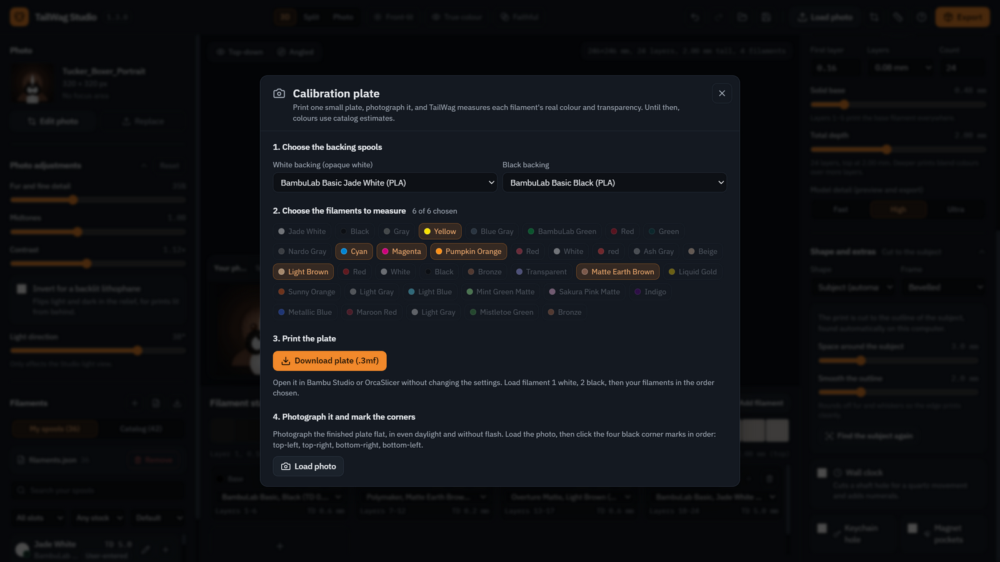

For the most accurate colours, choose up to six filaments and download a small test plate. Print it, take a photo in daylight, click the four corners, and TailWag measures each filament's real colour and transparency. From then on, previews use your measured values.

### About and updates
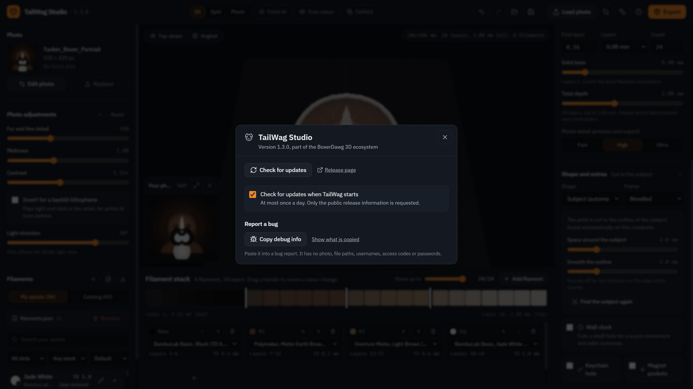

Click the version number at the top left to check for updates. **Copy debug info** copies what a bug report needs, without your photo or personal details.

---

## Installing on Windows, and the blue "Windows protected your PC" screen

Download **TailWag-Setup-1.4.1.exe** from the [releases page](https://github.com/everyday3d/tailwag/releases) and run it. There's also a portable version that doesn't need installing. You can also install it from a terminal:

```powershell
winget install everyday3d.TailWagStudio
```

TailWag Studio is a small project and the installer is **not code-signed yet**, so Windows may warn you the first time. This is normal for new apps and does not mean the file is harmful.

### The blue screen ("Windows protected your PC")
1. Click **More info** (the small link under the message).
2. Click **Run anyway**.

### Your browser says the file is "not commonly downloaded"
Choose **Keep** (in the downloads list, open the three dots, then **Keep**, then **Keep anyway**).

### The installer will not start
Right-click the downloaded `.exe`, choose **Properties**, tick **Unblock** at the bottom of the **General** tab, click **OK**, and run it again.

### Antivirus removed the file
Restore it from quarantine and add it to your antivirus exclusions, or use the portable version.

### Check that the file is the real one
The [releases page](https://github.com/everyday3d/tailwag/releases) lists a **SHA-256** checksum for each file. To compare, open PowerShell in your Downloads folder and run:

```powershell
Get-FileHash .\TailWag-Setup-1.4.1.exe -Algorithm SHA256
```

The two values should match.

## Installing on macOS (Apple Silicon & Intel)

Download the `.dmg` from the [releases page](https://github.com/everyday3d/tailwag/releases):
- **Apple Silicon (M1, M2, M3, M4):** `TailWag-Setup-1.4.1-mac-arm64.dmg`
- **Intel Macs:** `TailWag-Setup-1.4.1-mac-x64.dmg`

Open it and drag **TailWag Studio** into your **Applications** folder.

### First launch: Right-click > Open (Unsigned App Gatekeeper)

The app isn't signed with a paid Apple certificate yet, so the first time:

1. **Right-click (or Control-click)** TailWag Studio in **Applications**.
2. Choose **Open**, then click **Open** again.

After that it opens normally.

#### If macOS says the app "is damaged and can't be opened"
Open **Terminal** and run:
```bash
xattr -cr /Applications/TailWag\ Studio.app
```
Or open **System Settings > Privacy & Security**, scroll to **Security**, and click **Open Anyway**.

---

## Help and bug reports

Please report bugs on the [issue tracker](https://github.com/everyday3d/tailwag/issues). In the app, click the version number and use **Copy debug info**, then paste it into your report. The [wiki](https://github.com/everyday3d/tailwag/wiki) has more guides.

## For developers

TailWag Studio is an Electron, React and Three.js app. It also includes an experimental [MCP server](https://modelcontextprotocol.io) (`node dist-electron/mcp/server.js`) that lets AI agents list filaments, pick palettes and export projects. It uses a built-in demo picture, not your own photos. See the [wiki](https://github.com/everyday3d/tailwag/wiki) and [CHANGELOG.md](CHANGELOG.md) for details.

To build from source: `npm install`, then `npm run electron:win` or `npm run electron:mac`. The first build downloads the 224 MB subject-finder model.

## Notices and license

TailWag Studio is an independent project by BoxerDawg 3D. It is not affiliated with or endorsed by HueForge, Bambu Lab, Prusa or any filament maker, and their names belong to their owners. It includes the BiRefNet model and ONNX Runtime (both MIT). Full details are in [NOTICE.md](NOTICE.md), and catalog data sources are in [DATA_SOURCES.md](DATA_SOURCES.md).

Released under the [MIT License](LICENSE).
